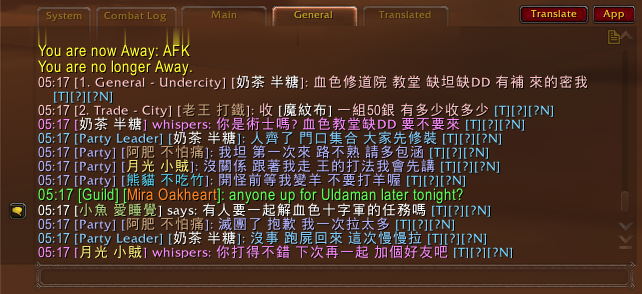
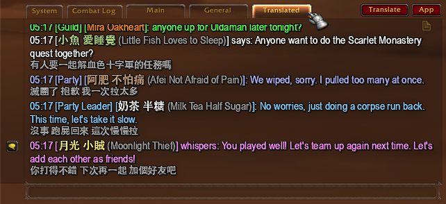
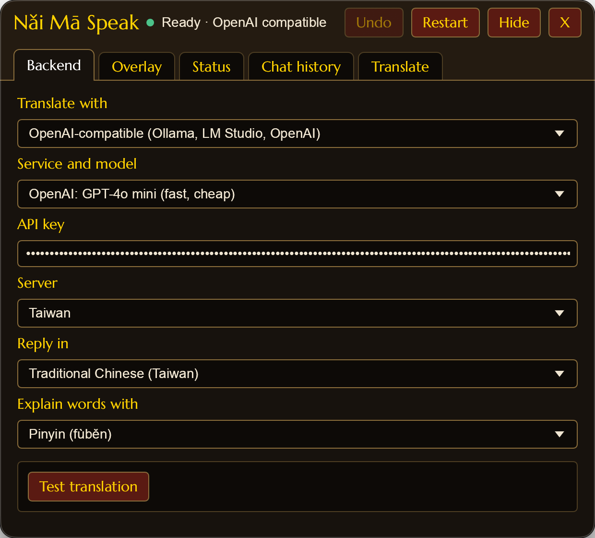

# Nǎi Mā Speak

Chat translation between Chinese and English for World of Warcraft, made for playing on a Taiwanese or Mainland server
without reading Chinese.

It reads Traditional and Simplified Chinese, and writes your replies in Traditional Chinese with Taiwanese wording, or
in Simplified.

Compatible with WoW Forever (1.60.1) and Retail (12.1.5). Runs on macOS, Windows & Linux.

**This has been extensively tested only on WoW Forever, on Taiwanese servers, and on macOS. Users report it also works
on Windows.**

  
  

  

This is a fork of [cherryroots/Translate](https://github.com/cherryroots/Translate), greatly expanding on the original.

奶媽 (nǎi mā, "wet nurse") is what Chinese-speaking players call a healer.

## How It Works

The system has two parts: an in-game AddOn and a companion app.

WoW AddOns cannot reach the internet, so the companion app reads the screen to grab the chat, translates it, and draws
the translation as a transparent click-through overlay over the game.

**We don't currently do OCR** (maybe soon). The AddOn captures the chat and transmits it to the companion via a block
of colored pixels (128x18 pixels). One advantage of this method is that the chat to be translated does not need to be
visible on screen.

**The companion app cannot talk to the AddOn.** This would employ the same methods as bots, and is therefore risky.

Once the app gets the line, it uses a third-party service to translate it: either a free translation service (Bing or
Google) or an LLM (bring your own API key). It then draws it back over the game (or somewhere else if you want) on a
translucent click-through overlay.

## Install

Download the app from the [latest release](https://github.com/norswap/nai-ma-speak/releases/latest).

You do not need to install the AddOn yourself; the app will offer to do so when you launch it.
(But if you want to install it manually, that is also feasible.)

The companion app is just a program you can run.

macOS: unzip, then double-click the `.app`, dismiss the warning, then go to *"System Settings" > "Privacy & Security"*,
scroll down to the message about "Nai Ma Speak" and click *"Open Anyway"*. Seriously, fuck you, Apple.

You will also need to grant screen recording permission.

Linux: run `chmod +x nai-ma-speak-linux-x64` once before running.

**Run WoW in "windowed" or "windowed (fullscreen)" mode**: overlays cannot draw over true fullscreen, and screen capture
may see a black screen there.

**If you supply API keys, they will be stored in plaintext in `config.json` next to the program.**
The program also writes a few more files next to it, so you may want to put it in its own directory.

To build from sources, see [CONTRIBUTING.md](./CONTRIBUTING.md).

## Features

In the default setup, the companion receives all chat lines from every chat window, translates those containing
Chinese, and draws them in a translucent click-through overlay. The overlay is hidden when the game isn't showing.

Hitting the *"Translate"* button near the chat brings up a textbox where you can type English text. Hitting Enter
translates it and sends it to your clipboard. You can use the `/tr` or `/nms` command to achieve the same (see below).

Every chat message containing Chinese (in its text or in the speaker's name) also allows you to request a new
translation by clicking `[T]` next to the message in the game's chat windows (useful when the free models are
rate-limited or for old messages).

When using AI models (OpenAI, Anthropic), you can also request a sentence breakdown (translates every word, and
shows phonetics and a short note) by clicking `[?]`. You can request an explanation of a Chinese player name via `[?N]`.

More features below. I've highlighted the important stuff **in bold**.

### Translation / Backend Features

- Select the translation provider.
  - The default is a mix of Google and Bing Translate, but the quality is lower and it is prone to rate-limiting
    and failures.
  - **You can put in your OpenAI or Anthropic API key for improved quality and reliability (recommended).**
    - The cost is a few cents a day with GPT-4o-mini.
  - You can also use any local model that serves an OpenAI-compatible API (e.g. via Ollama or LM Studio).
    - If you enter a base address like `http://localhost:1234`, the `/v1` suffix is added automatically.
- Choose between traditional and simplified Chinese for translating your messages.
- Choose between pinyin and bopomofo for phonetics.
- **Built-in knowledge of WoW slang, locations and abbreviations when using LLMs.**
- Links to items, quests, etc. are shown in your client's language (the name comes directly from your game client).
  - However, they are not clickable, as the overlay cannot be interacted with.

### Overlay Features

- The overlay is scrollable when anchored to a chat tab, and on macOS also when floating.
  - The overlay is not otherwise interactive.
  - On macOS, the scroll is sensitive to every "notch" in your scroll wheel (unlike the built-in chat).
  - You can select the number of lines that each scroll passes (in the companion app).
- The overlay behaviour can be customized in the *"Overlay"* tab of the companion app.
  - Choose whether to translate player names.
  - Choose whether to display the original Chinese line.
  - Show the overlay when the game isn't showing.
- **Only translate some messages by selecting a source window: only messages from that window will be translated and
  shown on the overlay.** (in the AddOn options)
- Select whether messages containing no Chinese are passed through the overlay or not (in the AddOn options).
- Reposition the overlay by unlocking it in the companion app and moving it around.
- **Select an empty chat window to anchor the overlay to, mimicking a native chat window (in the companion app).**
  - You can create such an empty tab in the AddOn options.
  - The overlay will be hidden when another tab is shown.

### History & Misc Features

By default, each character's overlay chat history is preserved separately. The history survives logout.

- **You can choose to merge all characters' overlay chat history instead, for a unified log.**
- You can configure the overlay scrollback (up to 2000 lines per character).
- Within that limit, you can configure how far back lines are brought back when the companion starts (e.g. the last
  hour / day / week, or all of them).

Other stuff:

- You can move the location of the pixel block in the AddOn options, or reposition it manually in edit mode.
- You can bring up the companion app via the *"App"* button for quick access.
- The companion app auto-updates itself and the AddOn.

## Limitations & Pitfalls

- **The pixel block must be visible (showing on the screen, not covered by another window).**
  - Lines missed while it was covered are sent again once it is visible: the AddOn keeps repeating its most recent
    lines while chat is quiet.

- **Doesn't work in "community channels".** (These chat messages are hidden from AddOns.)

- **The overlay isn't scrollable when floating on Windows & Linux.** Anchor it to a chat tab to get scrolling.

- Non-LLM services do not support the explanation modes (`[?]` and `[?N]`).

- Non-LLM services cannot take hints, so they do not benefit from the built-in knowledge of WoW slang, locations and
  abbreviations.

- Max message length is 376 bytes. This is big enough for all chat messages, but some system messages might get cut.

- The AddOn can transmit about 10 messages per second (minimum 4) via the pixel block. If messages come faster, they are
  queued up, up to 200. If the queue gets full, translations might get dropped, although you can always request a manual
  translation via the `[T]` button.

- Icons inside chat lines (raid markers and the like) are left out of the overlay.

- Colors in text may be dropped. Line color is preserved (e.g. green for guild chat), link (item/quest/...) color is
  order-matched (the first link in the translation gets the color of the first link in the original, which might be
  incorrect if the translation changes the link ordering). Bespoke coloring on normal words is lost, unless they appear
  as-is in the output.

- The pixel block must not be stretched. Stretching happens when anything enlarges the game's picture by a fraction:
  for instance, exclusive fullscreen at a different resolution than the screen, other forms of (up)scaling applied by
  the OS, or streaming.

## Troubleshooting

Please make sure you read through the [Limitations & Pitfalls](#limitations--pitfalls) section first.

If something goes wrong, go to the *"Status"* tab, click *"Copy report"*, and open an issue in this repository, with the
report and any additional useful details (your setup, what you already tried, etc.).

If the companion app crashes, please also attach the `nai-ma-speak.log` file that lives next to the program.

## In-Game Command Reference

The command prefix is `/tr` (for "translate") or `/nms` (for "Nai Ma Speak").

Everything the commands do can be achieved via the UI (*"Translate"* button in-game and AddOn or App options).

| Command | Does |
| --- | --- |
| `/tr` | Open or close the translate box |
| `/tr hello` | Translate and copy, then reopen the chat box on the channel it was last on |
| `/tr /g hello` | The same, reopening the chat box on that target: `/p`, `/s`, `/y`, `/ra`, `/i`, `/o`, `/2`, `/w Name`, `/r` |
| `/tr /name` | Explain your target's name in the overlay; `/tr /name 黑熊` for one you type |
| `/tr /options` | Open the AddOn's options |
| `/tr /all` | Toggle lines without Chinese in the overlay |
| `/tr /test` | Send a Chinese test line to the overlay, seen only by you, to check the block and overlay |
| `/tr /help` | List the commands |

There are some extra internal / troubleshooting commands:

| Command | Does |
| --- | --- |
| `/tr /test 10` | Send that many test lines, to the overlay only as well |
| `/tr /demo` | Play a made-up Chinese conversation in your chat window, seen only by you, to try the overlay when chat is quiet |
| `/tr /probe` | Report which client features the AddOn found |

## More Nerdy Details

(to be expanded)

- **Catching up.** While chat is quiet the AddOn keeps sending its last N chat lines again (the count is in the AddOn's
  options). Lines the companion missed, because another window covered the game or the companion was not running, appear
  in the overlay in their place within seconds; lines it has are not shown twice.